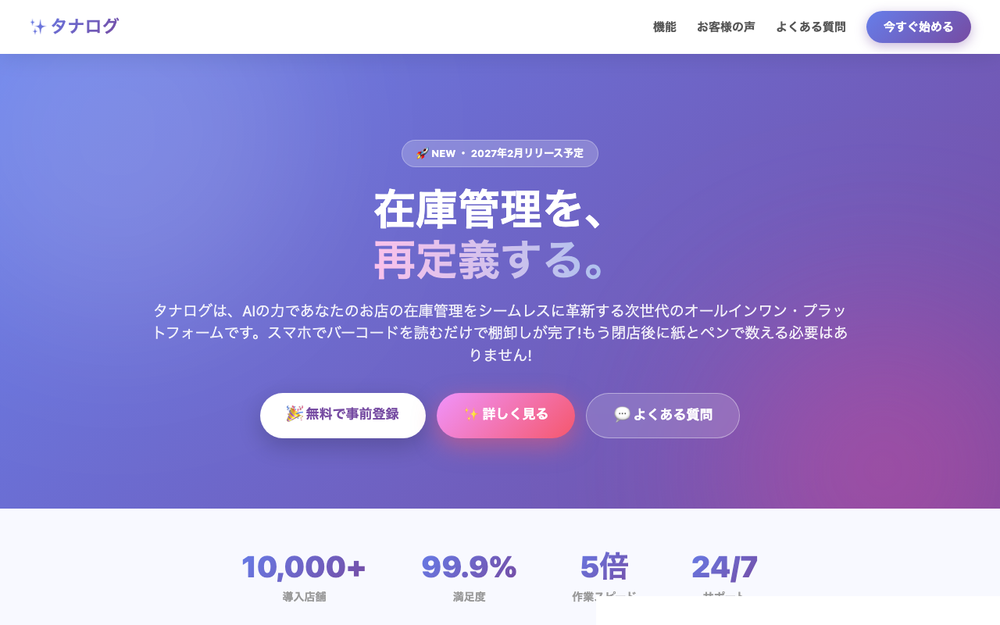
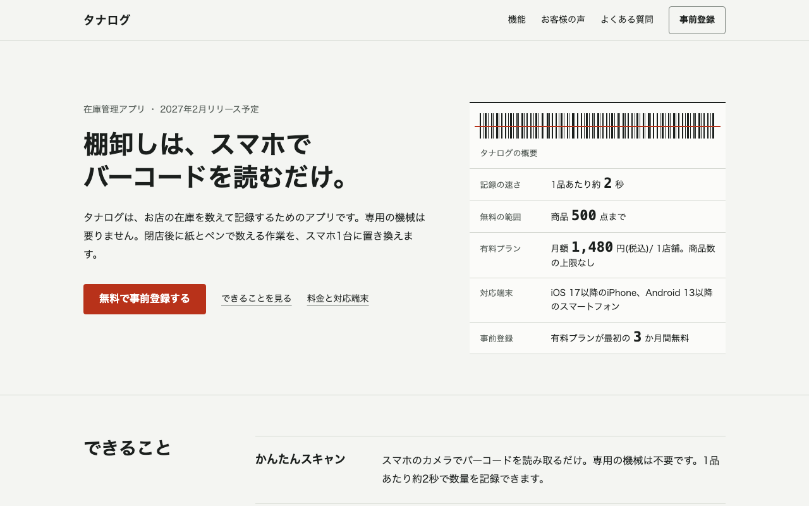
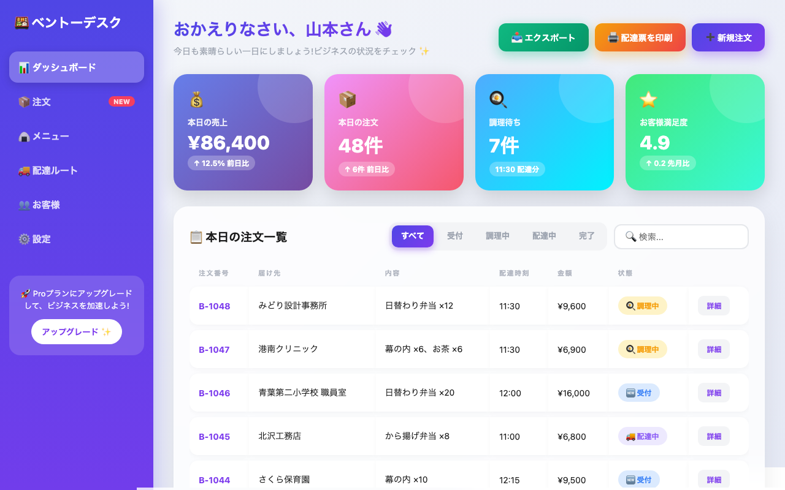
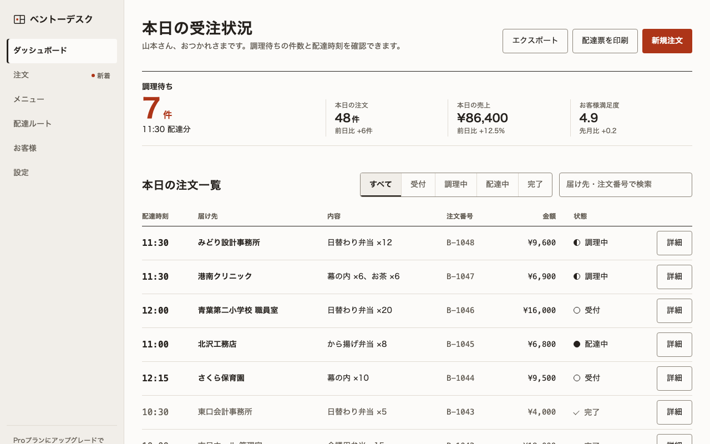
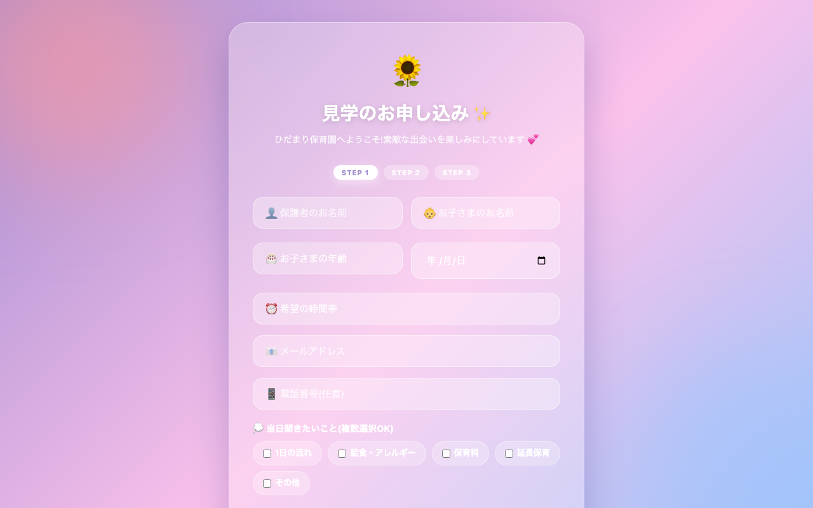
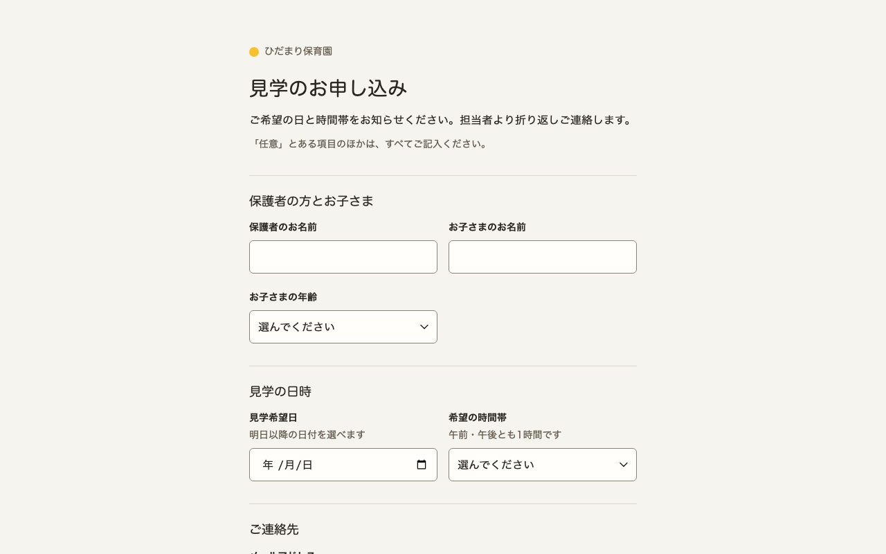
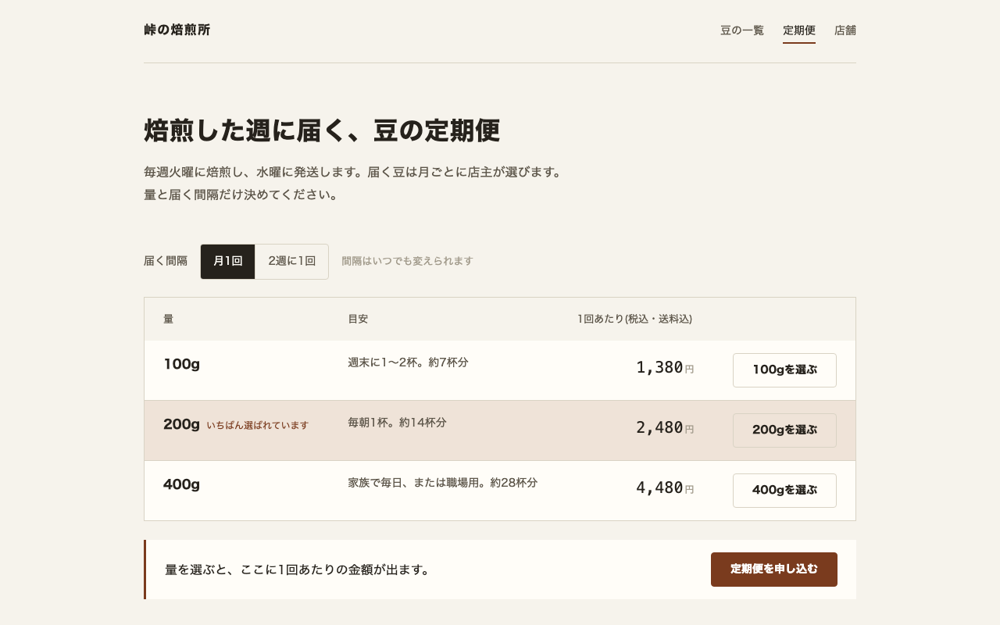
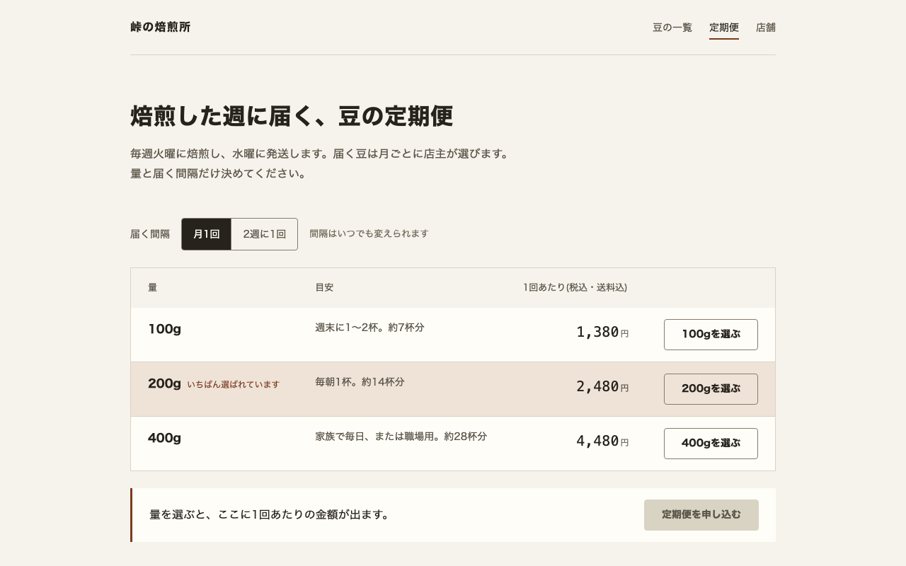
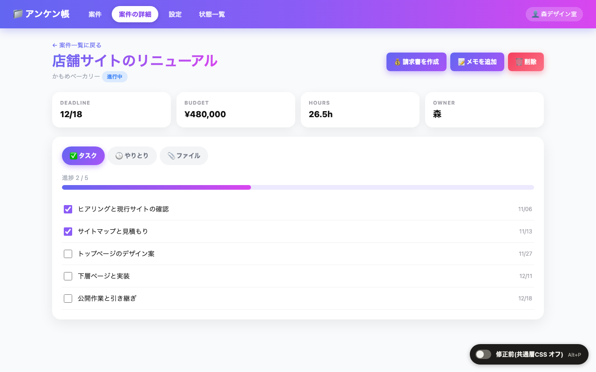
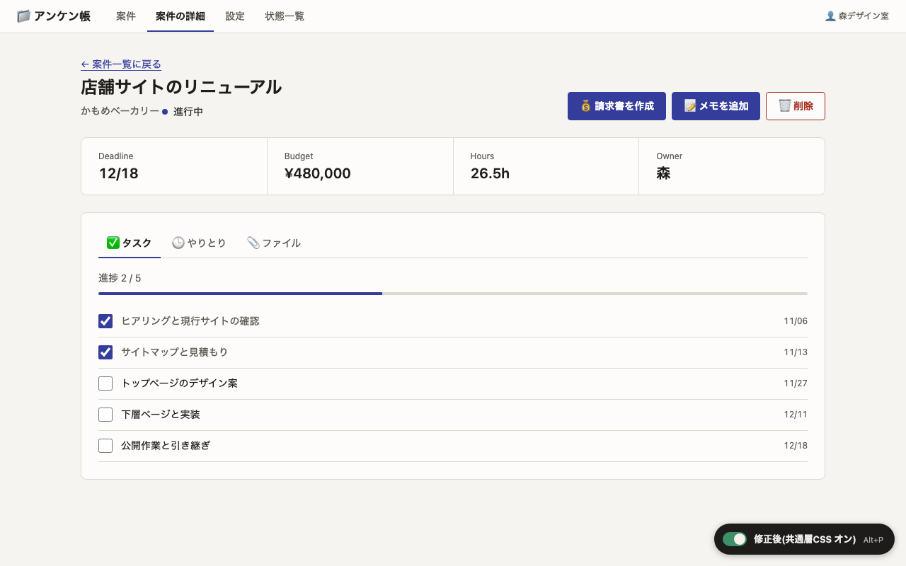

# design-polish

[English](README.md) | 日本語

決断が入っていない画面を、デザイナーが手直ししたような画面に改善する Agent Skill です。

色も余白も文言も、ライブラリやテンプレートや生成モデルの初期値がそのまま残っていると、どの画面も同じに見えます。「AIっぽい」と言われる画面も、急いで作った画面も、原因は同じです。このスキルは装飾を差し替えるのではなく、「誰のための画面で、どこを最初に見てほしいのか」を決め、そこから色・文字・余白を導きます。

| 修正前 | 修正後 |
|---|---|
|  |  |
|  |  |
|  |  |
|  |  |
|  |  |

上から、告知ページ、管理画面、フォーム、すでに良い画面(判定が「調整」で、ほとんど変わらない例)、複数ページ(共通層のCSSだけを当てた例)です。

修正後の画面は、スキルを読んだだけのエージェントの出力をそのまま載せています。手では整えていません。生成の条件は各見本の `generation.md` に記録してあります。

## 何をするか

- **原因から直す。** 「紫のグラデーション」という兆候ではなく、「色を選んでいない」という原因を直します。兆候だけ消すと、別の量産品になるだけです
- **判定で作業量を決める。** 診断の結果を「調整」「改修」「再構成」のどれかに判定し、必要な分だけ直します。すでに良い画面は作り直しません
- **機能は変えない。** 触るのは見た目と文言だけです。`id`、フォームの挙動、イベントハンドラ、リンク先はそのまま残します
- **複数ページは2層に分ける。** サイト共通層(色・文字・余白の体系と部品の見た目)と、ページ固有層(構成、主役、文言)に分け、型の違う代表ページを3〜5枚だけ読みます
- **結果は切り替えて見せる。** 修正の前後を、同じ位置で切り替えられる1ファイルのページで見せます
- **数える・計算する・突き合わせる作業は機械に任せる。** コントラスト比の計算、修正前後の突き合わせ、値の棚卸しなどは同梱のスクリプトで行います。スクリプトを実行できない環境では、同じことを手作業の手順で行います

React、Vue、Svelte、Tailwind、素のHTML/CSSに対応します。画像生成やブラウザ自動操作などの外部ツールは必須にしていません。

## 導入

### `skills` コマンドで入れる

Node.js があれば、次の1行で導入できます。

```bash
npx skills add c-tomioka/design-polish
```

入れる先のエージェントと、範囲(すべてのプロジェクトか、今のプロジェクトだけか)は、実行中の質問で選びます。

### 手で置く

`skills/design-polish` フォルダを、Claude Code のスキル置き場に置きます。

```bash
git clone https://github.com/c-tomioka/design-polish.git
```

すべてのプロジェクトで使う場合は `~/.claude/skills/` に置きます。

```bash
cp -r design-polish/skills/design-polish ~/.claude/skills/
```

特定のプロジェクトだけで使う場合は、そのプロジェクトの `.claude/skills/` に置きます。

```bash
mkdir -p .claude/skills && cp -r /path/to/design-polish/skills/design-polish .claude/skills/
```

このリポジトリ自体には、`.claude/skills/design-polish` から `skills/design-polish` へのシンボリックリンクが入っています。リポジトリを Claude Code で開けば、そのままスキルを試せます。

## 見本の見方

見本は5種類あります。

| 見本 | 内容 | 見どころ |
|---|---|---|
| 告知ページ | 在庫管理アプリの事前登録ページ | 定型の構成と、根拠のない数字・推薦文の扱い |
| 管理画面 | 宅配弁当の受注管理 | 毎日使う作業画面としての密度と色の役割 |
| フォーム | 保育園の見学申し込み | ラベル、エラー文、読みやすさ |
| すでに良い画面 | 珈琲豆の定期便の料金ページ | 判定が「調整」になり、小さな改善にとどまる例 |
| 複数ページ | 部品を共有する3ページの案件管理 | 共通層のCSSを画面上でオン・オフする。状態一覧ページつき |

見方は3通りあります。

1. **この README の画像**:上の表が修正前後のスクリーンショットです
2. **GitHub Pages**:<https://c-tomioka.github.io/design-polish/> で比較ビューアが開きます(リポジトリの設定で、Pages の公開元を `main` ブランチの `/docs` にした場合)
3. **ローカル**:リポジトリを取得し、`docs/index.html` をブラウザで開きます。サーバーもビルドも要りません

比較ビューアでは、次のことができます。

- 修正前と修正後を、同じ位置で切り替える
- 広い画面では左右に並べる
- 表示幅をスマホ幅(375px)とPC幅で切り替える
- 修正前・修正後をそれぞれ単体で開く
- 診断(`diagnosis.md`)と、生成条件の記録(`generation.md`:モデル名、日付、依頼文)を読む

複数ページの見本は、画面右下のボタン(または Alt + P)で共通層のCSSをオン・オフします。モーダルやタブを開いたまま切り替えられます。

見本はすべて静的なHTML/CSS/JSで、外部からは何も読み込みません。

## 自分の画面で試す

スキルを導入した状態で、Claude Code に画面を渡して頼みます。

```
src/pages/Pricing.tsx のデザインを良くしてください
```

```
このスクリーンショットの画面、AIっぽさを消したいです
```

```
管理画面の一覧・詳細・設定の3ページを、まとめて整えてください
```

スキルは次の順で進めます。

1. 画面を読んで診断し、判定(調整/改修/再構成)と方向性を見せる
2. 了承を得てから直す(「任せる」と言えば確認を省きます)
3. 検証して報告し、前後を切り替えられるページを渡す

先にどう変わるのかを見たいときは、「見本を見せて」と頼むと、同梱の比較ページ(`assets/example-compare.html`)が表示されます。

### 同梱の道具

`skills/design-polish/assets/` に、確認のための静的なファイルが入っています。スキルが使うほか、単体でも使えます。

| ファイル | 用途 |
|---|---|
| `toggle-snippet.js` | 共通層のCSSを同じ画面上でオン・オフする。開発環境のページに貼る |
| `bookmarklet-builder.html` | CSSを貼ると、同じ切り替えをするブックマークレットを作る。手を入れられないサイト用 |
| `state-gallery-template.html` | 部品を全状態(通常、ホバー、フォーカス、無効、読み込み中、空、エラー)で並べるひな形 |
| `compare-template.html` | 修正前後のHTMLを1ファイルに埋め込む前後比較ページのひな形 |
| `example-compare.html` | 比較ページの実例 |

`skills/design-polish/scripts/` には、検証を機械に任せるためのスクリプトが入っています。Python 3.8 以降の標準ライブラリだけで動き、インストールするものはなく、通信もしません。

| スクリプト | すること |
|---|---|
| `contrast.py` | 文字色と背景色のコントラスト比を計算する |
| `check_parity.py` | 修正前後のHTMLを突き合わせ、`id`・`name`・リンク先・操作要素の数・スクリプトの差分を調べる |
| `check_external.py` | 外部からの読み込みがないかを調べる |
| `inventory.py` | CSSに書かれた色・文字サイズ・余白・角丸・影の種類を数える |
| `build_compare.py` | 修正前後のHTMLを埋め込んだ前後比較ページを作る |

```bash
python3 skills/design-polish/scripts/check_parity.py docs/examples/landing/before.html docs/examples/landing/after.html
```

スクリプトを実行できない環境(コード実行が使えないブラウザ版やスマホアプリなど)でも、スキルは動きます。その場合、エージェントは同じ確認を読み取りと計算で行い、どちらの方法で確かめたかを報告に書きます。

## リポジトリの構成

```
skills/design-polish/
  SKILL.md              スキル本体
  references/           複数ページの進め方、確認と見せ方の詳細
  assets/               切り替えスニペット、ひな形、比較ページの実例
  scripts/              検証用のスクリプト(Python 標準ライブラリのみ)
docs/
  index.html            比較ビューア
  examples/             見本(before / after / diagnosis / generation)
  screenshots/          README 用の画像
.claude/skills/design-polish  → skills/design-polish へのシンボリックリンク
CHANGELOG.md            変更履歴
```

`tmp/` と `.output/` は Git の管理から外してあります。試しに作った比較ページや、スクリプトの出力など、一時的なファイルの置き場として使えます。

## バージョン

現在のバージョンは 0.0.1 です。`skills/design-polish/SKILL.md` の `metadata.version` に書いてあり、手元に置いたスキルの版はそこで確かめられます。変更の記録は [CHANGELOG.md](CHANGELOG.md) にあります。

## ライセンス

[LICENSE](LICENSE) を参照してください。
