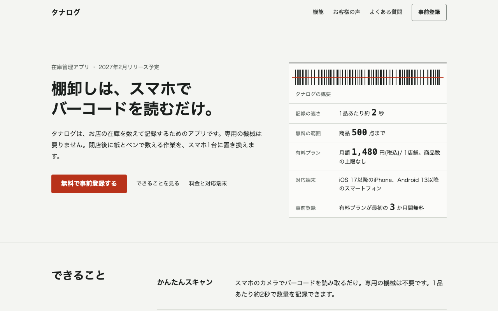
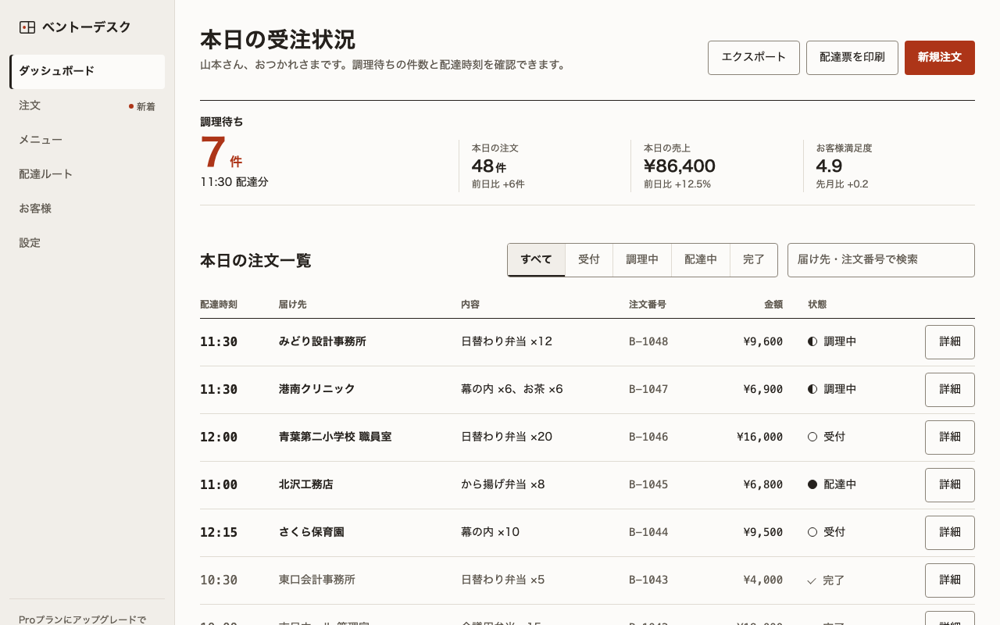
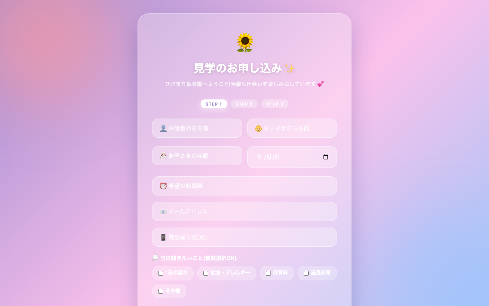
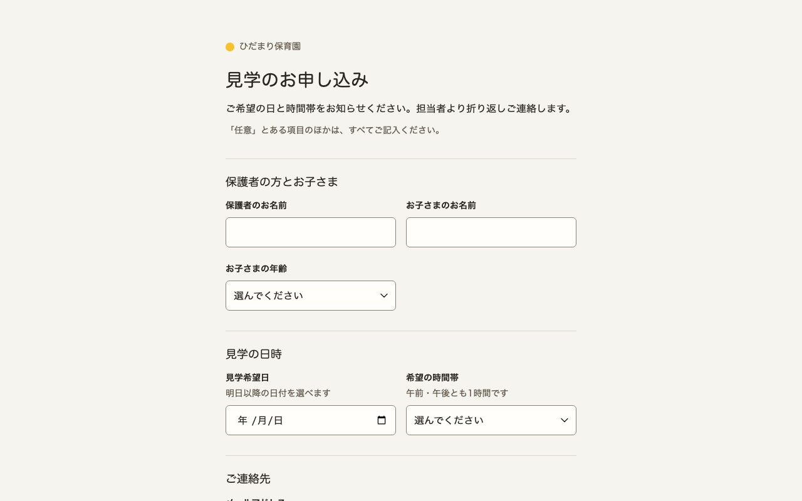
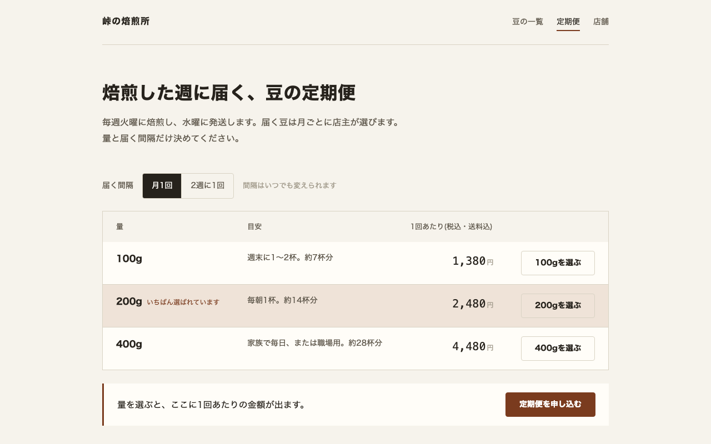
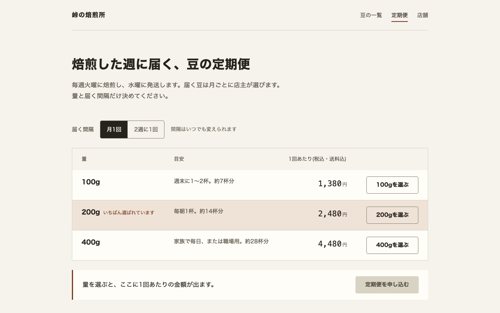
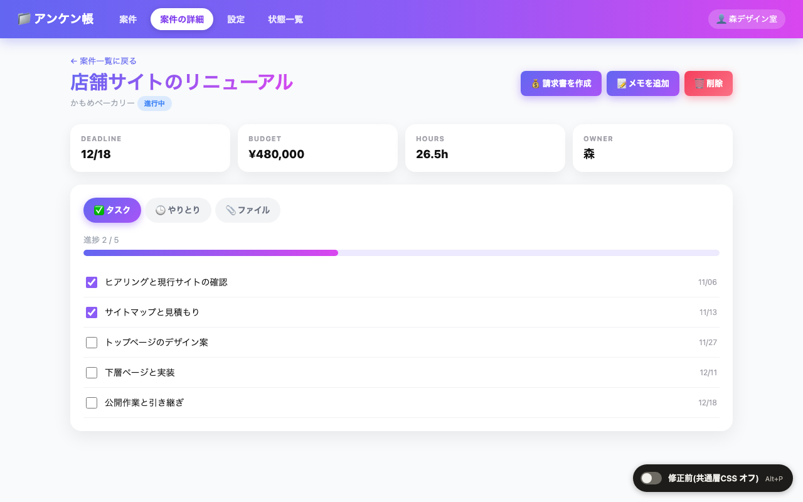
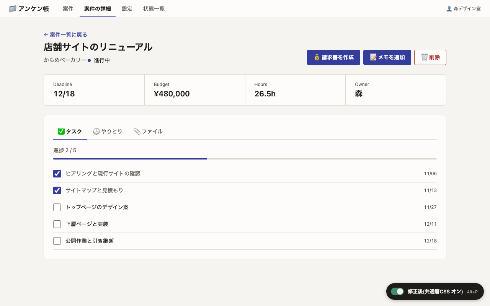

# design-polish

English | [日本語](README.ja.md)

An Agent Skill that takes a screen nobody made decisions about and reworks it the way a designer would.

When the colors, spacing, and copy are still the defaults of a library, a template, or a generative model, every screen ends up looking the same. That is true of screens people call "AI-looking" and of screens someone built in a hurry. This skill does not swap one decoration for another. It decides who the screen is for and what they should see first, then derives color, type, and spacing from that decision.

| Before | After |
|---|---|
|  |  |
|  |  |
|  |  |
|  |  |
|  |  |

From top to bottom: a landing page, a dashboard, a form, a screen that was already good (the verdict was "adjust", so it barely changes), and a multi-page site with only the shared CSS layer applied.

Every "after" screen is the unedited output of an agent that had read nothing but the skill. Nothing was touched up by hand. The conditions for each run are recorded in that example's `generation.md`.

> **Language note.** The skill itself (`SKILL.md`, its references, the examples, and the scripts' output) is written in Japanese. Only this README is in English. Claude follows the skill regardless of the language you talk to it in.

## What it does

- **Fixes the cause, not the symptom.** The problem is "nobody chose a color", not "there is a purple gradient". Remove only the symptom and you get a different kind of mass-produced look.
- **Sizes the work by a verdict.** The diagnosis ends in one of three verdicts (adjust, renovate, or restructure) and the skill changes only as much as that calls for. A screen that is already good is not rebuilt.
- **Leaves behavior alone.** It touches appearance and copy only. `id`s, form behavior, event handlers, and link targets stay as they are.
- **Splits multi-page work into two layers.** A site-wide layer (the color, type, and spacing system, plus how components look) and a page-specific layer (structure, focal point, copy). It reads three to five representative pages of different types instead of crawling the whole site.
- **Shows the result as a switch.** You get a single self-contained page that flips between before and after in the same position.
- **Hands counting, calculating, and comparing to scripts.** Contrast ratios, before/after parity checks, and value inventories run through bundled scripts. Where scripts cannot run, the skill does the same checks by hand.

It works with React, Vue, Svelte, Tailwind, and plain HTML/CSS. It does not require external tools such as image generation or browser automation.

## Install

Put the `skills/design-polish` folder where Claude Code looks for skills.

```bash
git clone https://github.com/c-tomioka/design-polish.git
```

To use it in every project, put it in `~/.claude/skills/`.

```bash
cp -r design-polish/skills/design-polish ~/.claude/skills/
```

To use it in one project only, put it in that project's `.claude/skills/`.

```bash
mkdir -p .claude/skills && cp -r /path/to/design-polish/skills/design-polish .claude/skills/
```

This repository already contains a symlink from `.claude/skills/design-polish` to `skills/design-polish`, so you can open the repository in Claude Code and try the skill right away.

## Viewing the examples

There are five examples.

| Example | What it is | What to look at |
|---|---|---|
| Landing page | Pre-registration page for an inventory app | Template structure, and how unsupported numbers and testimonials are handled |
| Dashboard | Order management for a lunch delivery service | Density for a screen used all day, and the role each color plays |
| Form | Visit request form for a nursery school | Labels, error messages, readability |
| Already-good screen | Pricing page for a coffee bean subscription | The verdict is "adjust" and the changes stay small |
| Multi-page | A three-page project tracker with shared components | Toggling the shared CSS layer in place, with a state gallery page |

You can view them in three ways.

1. **Images in this README.** The table above shows before and after screenshots.
2. **GitHub Pages.** The comparison viewer opens at <https://c-tomioka.github.io/design-polish/>, provided Pages is set to publish from the `/docs` folder of the `main` branch in the repository settings.
3. **Locally.** Clone the repository and open `docs/index.html` in a browser. No server and no build step.

In the comparison viewer you can:

- Switch between before and after in the same position
- Place them side by side on a wide screen
- Change the viewport between phone width (375px) and desktop width
- Open the before or after screen on its own
- Read the diagnosis (`diagnosis.md`) and the generation record (`generation.md`: model, date, prompt)

In the multi-page example, the button at the bottom right of the screen (or Alt + P) turns the shared CSS layer on and off. It works with a modal or a tab left open.

All examples are static HTML, CSS, and JS, and load nothing from outside.

## Trying it on your own screens

With the skill installed, hand Claude Code a screen and ask.

```
Improve the design of src/pages/Pricing.tsx
```

```
I want this screenshot to stop looking AI-generated
```

```
Polish the list, detail, and settings pages of the admin console together
```

The skill proceeds in this order.

1. It reads the screen, diagnoses it, and shows you the verdict and the direction it proposes.
2. It makes the changes once you agree. If you tell it to go ahead on its own judgment, it skips the confirmation.
3. It verifies, reports, and gives you a page that switches between before and after.

To see what kind of change to expect first, ask it to show you an example. It will display the bundled comparison page (`assets/example-compare.html`).

### Bundled tools

`skills/design-polish/assets/` holds static files for checking results. The skill uses them, and they also work on their own.

| File | Purpose |
|---|---|
| `toggle-snippet.js` | Turns the shared CSS layer on and off in place. Paste it into a page in your development environment |
| `bookmarklet-builder.html` | Paste CSS and get a bookmarklet that does the same toggle. For sites you cannot edit |
| `state-gallery-template.html` | Template that lays out components in every state (default, hover, focus, disabled, loading, empty, error) |
| `compare-template.html` | Template for a before/after page with both HTML documents embedded in one file |
| `example-compare.html` | A finished comparison page |

`skills/design-polish/scripts/` holds scripts that take over the mechanical checks. They run on the Python 3.8+ standard library alone, need nothing installed, and make no network requests.

| Script | What it does |
|---|---|
| `contrast.py` | Calculates the contrast ratio between a text color and a background color |
| `check_parity.py` | Compares the before and after HTML: `id`s, `name`s, link targets, the number of interactive elements, and script differences |
| `check_external.py` | Checks that nothing is loaded from outside |
| `inventory.py` | Counts the distinct colors, font sizes, spacing values, radii, and shadows written in the CSS |
| `build_compare.py` | Builds a before/after comparison page with both HTML documents embedded |

```bash
python3 skills/design-polish/scripts/check_parity.py docs/examples/landing/before.html docs/examples/landing/after.html
```

The skill still works where scripts cannot run, such as a browser or mobile client without code execution. In that case the agent does the same checks by reading and calculating, and says in its report which method it used.

## Repository layout

```
skills/design-polish/
  SKILL.md              The skill itself
  references/           Details on multi-page work, and on checking and presenting results
  assets/               Toggle snippet, templates, a finished comparison page
  scripts/              Verification scripts (Python standard library only)
docs/
  index.html            Comparison viewer
  examples/             Examples (before / after / diagnosis / generation)
  screenshots/          Images for the README
.claude/skills/design-polish  → symlink to skills/design-polish
CHANGELOG.md            Change history (Japanese)
```

`tmp/` and `.output/` are ignored by Git. Use them for temporary files such as a trial comparison page or script output.

## Version

The current version is 0.0.1. It is written in `metadata.version` in `skills/design-polish/SKILL.md`, which is where you can check the version of a copy you have installed. Changes are recorded in [CHANGELOG.md](CHANGELOG.md).

## License

See [LICENSE](LICENSE).
